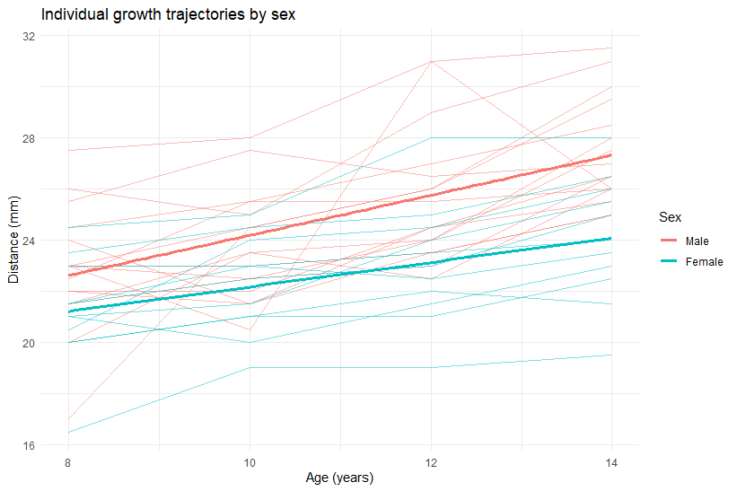
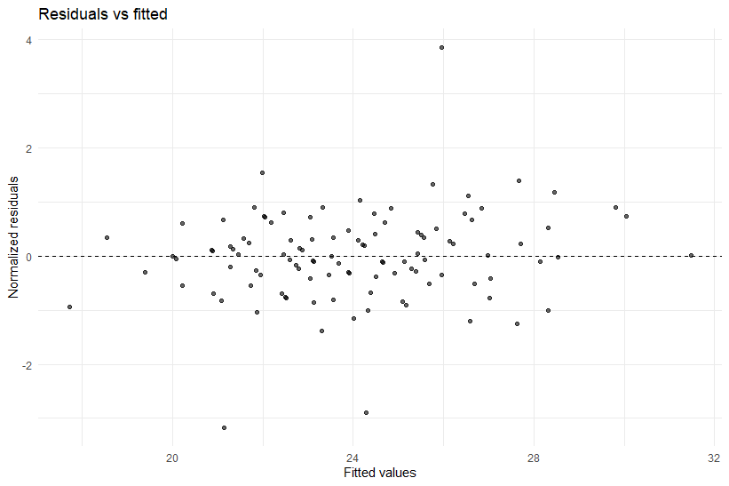
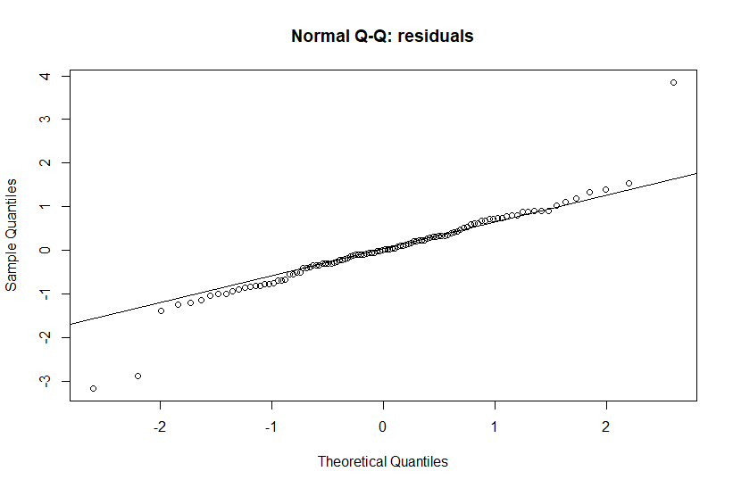
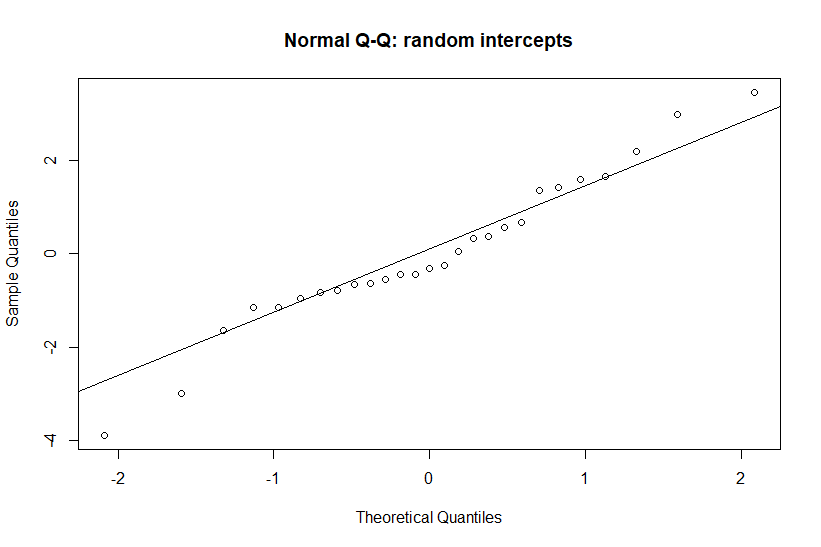
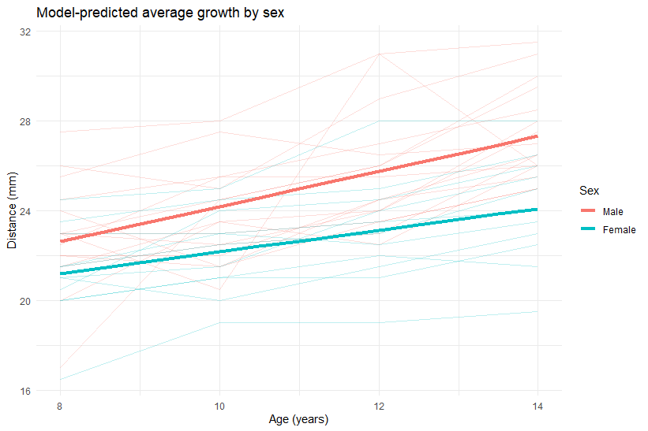

# Linear Mixed-Effects Models for Orthodontic Growth Data

## Overview

This project studies how jaw growth changes with age in children, and whether growth differs between boys and girls. Because the same child is measured repeatedly, I used linear mixed-effects models, which allow each child to have their own starting level and growth rate.

## Data

- Source: the `Orthodont` dataset from the `nlme` package in R
- 27 children, each measured 4 times between ages 8 and 14 (108 observations)
- `distance` : distance in mm from the pituitary to the pterygomaxillary fissure (outcome)
- `age` : age in years
- `Subjects` : Child ID
- `Sex` : Male or Female

## Methods

- Plotted each child's growth trajectory by sex.
- Compared a random-intercept model with a random-intercept and random-slope model.
- Compared models with `age` , `age + Sex` and `age * Sex` as fixed effects , using maximum likelihood.
- Refitted the final model using REML.
- Calculated the interclass correlation (ICC) and 95% confidence intervals for the fixed effects.
- Checked the model using residual plots and Q-Q plots.

## R Packages

- `nlme` : fitting the mixed-effects models (`lme`) and the `Orthodont` data
- `ggplot2` : plots

## Results

### Growth trajectories

Each thin lines is one child ( 16 boys, 11 girls); thick line shows the average linear trend for each sex. Most children show an upward trend, but starting levels and growth rates differ between children. Boys appear to grow faster than girls.

### Random effects structure

| Model | df | AIC | BIC | LogLik | Test | L. Ratio | p-value | 
| --- | --- | --- | --- | --- | --- | --- | --- |
| Random intercept (m1) | 4 | 455.00 | 465.66 | -223.50 | | | |
 Random intercept + slope (m2) | 6 | 454. 64 | 470.62 | -221.32 | 1 vs 2 | 4.37 | 0.1127 |

 The Likelihood ratio Test (LRT = 4.37, P= 0.113> 0.05) showed no significant improvement after adding a random slope. The AIC values were also very similar (455.00 vs. 454.64).

 Although the random slope model did not provide a significant improvement, I retained it in subsequent analyses to account for potential individual differences in growth rates among children. 

 ### Fixed effect structure

 | Model | df | AIC | BIC | LogLik| Test | L.Ratio | p-value | 
 | --- | --- | --- | --- | --- | --- | --- | --- |
 | `age` (m_noSex) | 6 | 451.21 | 467.30 | -219.6058 | | | |
 | `age + Sex ` (m_sex) | 7 | 446.8352 | 465.6101 | -216.4176 | 1 vs 2 | 6.37644 | 0.0116 |
 | `age * Sex` (m_int) | 8 | 443.8352 | 465.2630 | -213.9030 | 2 vs 3 | 5.02921 | 0.0249 |

Adding `Sex` significantly improve the model ( p = 0.0116 ).  Adding the age-by-sex interaction also provided a significant improvement ( p = 0.0249). The interaction model had the lowest AIC ( 443.8352) and also the lowest BIC (465.2630). Based on the likelihood ratio tests, AIC and BIC, I selected the interaction model as the final model. 

This suggests that the relationship between age and `distance` differs between boys and girls.
 
### Final model

| Term | Estimate | Std. Error | 95% CI | p-value |
|---|---|---|---|---|
| Intercept | 16.341 | 1.019 | 14.313 to 18.368 | <0.0001 |
| `age` | 0.784 | 0.086 | 0.613 to 0.956 | <0.0001 |
| `Sex` (Female) | 1.032 | 1.596 | -2.254 to 4.319 | 0.5237 |
| `age:Sex` (Female) | -0.305 | 0.135 | -0.573 to -0.037 | 0.0264 |

Boys are the reference group.

- **Intercept:** the estimated `distance` for boys at age 0 (16.34 mm). This is outside the observed age range (8 to 14 years), so it is not interpreted.
- **`age`:** for boys, `distance` increased by about 0.78 mm per year (95% CI 0.613 to 0.956).
- **`Sex` (Female):** the difference between girls and boys at age 0 was small and not significant (p = 0.5237).
- **`age:Sex` (Female):** the growth rate of girls was 0.30 mm per year lower than that of boys (95% CI -0.573 to - 0.037, p = 0.0264). This means the growth rate differs between boys and girls.

The estimated growth rate for girls was therefore about 0.48 mm per year (0.784 - 0.305).

Random effects of the final model (from `summary(m_final)`):

| Component | Standard deviation |
|---|---|
| Intercept (between children) | 2.41 |
| `age` slope (between children) | 0.18 |
| Residual | 1.31 |

The correlation between the random intercept and the random slope was -0.67.

### Intraclass correlation (ICC)

The ICC from the random-intercept model (m1) was 0.69. This means that about 69% of the variation in `distance` that age did not explain was due to differences between children, and the rest was variation within children. 

### Diagnostics

The residuals vs fitted plot showed no clear pattern, and the points were scattered around zero. Two points had large residuals (above 3 and below -3), which may be outliers. 

The Q-Q plot shows that most points closely follow the straight line, meaning the residuals are approximately normally distributed, with only minor deviations at the extreme ends.

Most points closely follow the reference line, indicating that the random intercepts are approximately normally distributed, with only minor deviations at the tails. 

## Predicted growth

The thick lines shows the average growth predicted by the final model for both sexes, and the thin lines show the observed trajectories of individual children. The line for boys is steeper than the line for girls, so the gap between them gets large with age. At age 8 the predicted `distance` was about 22.6 mm for boys and 21.2 mm for girls, and at age 14 it was about 27.3 mm for boys and 24.1 mm for girls.
